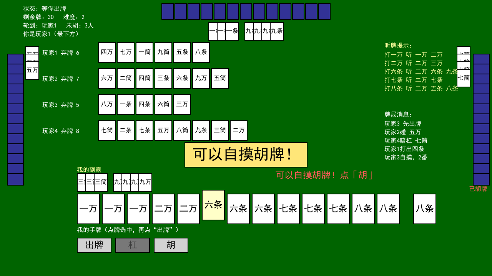
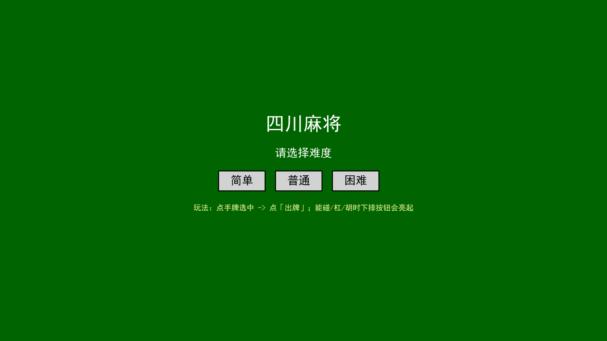
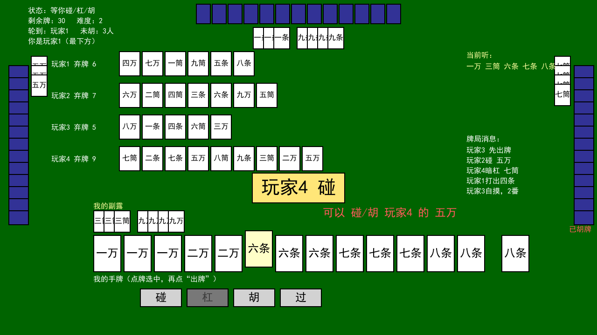
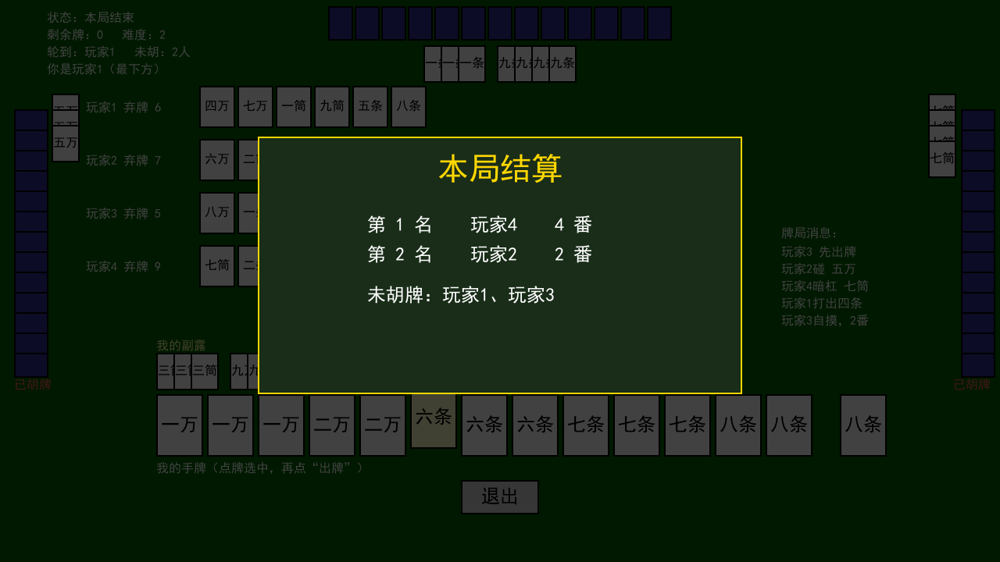

# 四川麻将（pygame）

一个用 Python + pygame 实现的四川麻将游戏，包含完整的牌局逻辑、AI 出牌策略和图形界面。



## 运行

需要 Python 3 与 pygame：

```bash
pip install pygame
cd mahjong
python UI_test_back.py
```

游戏内按 `X` 退出。

### 打包成 exe

```bash
pyinstaller -F -w -n 四川麻将 UI_test_back.py
```

## 项目结构

```
.
├── README.md
├── .gitignore
└── mahjong/                    ← 全部游戏文件都在这一层
    ├── UI_test_back.py         主程序（图形界面 + 状态机）
    ├── UI_test.py              早期简化版界面 ⚠️ 见下方说明
    ├── tile.py                 牌型定义、判胡/番数计算、AI 策略
    ├── tile_back.py            早期版本（留档）
    ├── main.py                 入口草稿（仅开一个空窗口）
    ├── settings.py             占位文件 ⚠️ 见下方说明
    ├── test.txt                一局运行的文字日志（留档）
    └── dsh/                    开发期用的验证脚本
        ├── verify.py             校验判胡/番数逻辑（对照穷举实现）
        ├── ui_paths.py           逐条验证状态机（碰/杠/胡/过/结算）
        ├── ui_autoplay.py        无头自动对局测试
        ├── ui_snapshot.py        无头渲染截图
        ├── probe_ai_pon.py       排查「AI 不肯碰/杠」的原因
        └── shots/                对局截图（由 ui_snapshot.py 生成）
```

### ⚠️ 关于两个失效文件

以下两个文件**无法通过 Python 编译**，作为开发过程的留档保留，**不要试图运行**：

| 文件 | 问题 |
|---|---|
| `settings.py` | 只有一行 `class Tiles`，类名后缺冒号、也没有类体 |
| `UI_test.py` | 第 279 行附近有语法错误（早期版本的遗留问题） |

**这不影响游戏运行**——可用的入口是 `UI_test_back.py`，它只依赖 `tile.py`。
两个文件均已通过编译检查。

## 游戏机制

`UI_test_back.py` 的状态机流程：

```
game_begin -> wait_discard / ai_turn -> wait_response -> ... -> game_over
```

| 机制 | 说明 |
|---|---|
| 出牌后的统一入口 | `open_response()`：先判**点炮胡**（胡优先），再判碰/杠 |
| 响应询问范围 | 碰/杠只问**离出牌者最近的一家** |
| 已胡玩家 | 在「轮转」和「响应扫描」中都会被跳过 |
| 结束条件 | 牌堆摸完，或只剩 1 人未胡 |
| 轮转职责 | `switch_turn()` 只负责「轮到谁」，**绝不覆盖** `wait_response` |

## 开发脚本用法

这些脚本用于验证逻辑，**不会修改游戏文件**：

```bash
cd mahjong

python dsh/verify.py          # 对 tile.py 的判胡/番数做穷举对照
python dsh/ui_paths.py        # 构造局面直接调用界面函数，断言结果
python dsh/ui_autoplay.py     # 无头自动对局
python dsh/ui_snapshot.py     # 生成界面截图到 dsh/shots/
python dsh/probe_ai_pon.py    # 排查 AI 碰/杠行为
```

> 说明：`dsh/` 这个目录名是开发期留下的，与 DeepSeek Harness 无关，
> 里面全部是**本游戏的测试与诊断脚本**。脚本通过 `Path(__file__).parent.parent`
> 定位上一层的游戏文件，因此**请保持这个嵌套结构**。

## 截图

| 开局 | 我方回合 |
|---|---|
|  |  |

| 响应他方出牌 | 结算 |
|---|---|
|  |  |
